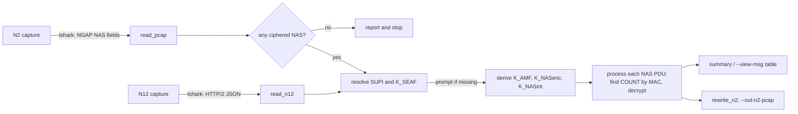

# NAS-Deciphering

Decrypts 5G NAS messages protected with **128-5G-EA2 / 128-5G-IA2** in an N2 (NGAP) capture,
and writes a copy of the capture that Wireshark opens with the NAS already in clear.

The keys can be taken straight from the trace: if the capture also holds the N12
signalling (AMF ↔ AUSF), the script reads K_SEAF and the SUPI from it, so in the common
case you only point it at a pcap.

```
uv run python nas_ea2_decode.py --pcap trace.pcap --out-n2-pcap trace_decrypted.pcap
```

```
SUPI   = imsi-440110000001519   (from N12 frame 5)
AMF IP = 240b:c0e0:205:2024:c901:1:c9:2201   (from Registration Request in frame 1)

ctx#0:   (K_SEAF from N12 frame 17)
  K_SEAF   = 835d8ee49c1ba19b11773ea4f6b3ce7ad77766f4f0beb7b9c294305520eef93b
  K_AMF    = 65b0a20b51b489211ccec9f2663c67850dd91cf2fd01516012f36bb16b92f2d9
  K_NASenc = 3a394334810d09a42e01f739f5fbbba0
  K_NASint = 269f68aa38c76efcfdc8642468a6a0f5

28 NAS messages: 6 plain, 22 MAC verified   (--view-msg to list them)
```

> **Captures contain subscriber identities and, with N12, K_SEAF in clear.** Keep them out
> of the repository: `.gitignore` already excludes `Traces/`, `*.pcap`, `*.pcapng` and TLS
> key logs.

---

## Functionality

1. **Checks that there is something to decrypt.** If no NAS message in the trace is
   ciphered (security header type 2 or 4), it says so and stops: no key or SUPI is needed.
2. **Finds the keys.** From `--kseaf` / `--kamf` if given; otherwise from the trace:
   - **N12** — the `Nausf_UEAuthentication` response that reports `AUTHENTICATION_SUCCESS`
     (`kseaf` for 5G AKA, `kSeaf` for EAP-AKA').
   - **GTPv2** — for 4G↔5G interworking (N26), an EPS security context (K_ASME + uplink
     NAS COUNT) carried in a Context Response / Forward Relocation Request, from which a
     mapped K'_AMF is derived (TS 33.501 Annex A.14).

   Every key found becomes one security context, so a capture with several UEs — or one UE
   moving from 4G to 5G — is decrypted in a single pass; each NAS message is matched against
   all contexts by its MAC.
3. **Finds the SUPI**, in this order:
   - `--supi`;
   - N12: the `supi` of that response, or the `supiOrSuci` of the authentication request
     it belongs to (`imsi-…` or a null-scheme `suci-0-…`), linked through the
     authentication context ID;
   - N2: the first null-scheme SUCI in a Registration Request or Identity Response.

   A SUCI concealed with ECIES (Profile A/B) or a 5G-GUTI does not reveal the SUPI.
4. **Asks for what is missing.** If the SUPI or the key cannot be found, it is asked for at
   the terminal (prefix a key with `kamf:` to give a K_AMF). When not run from a terminal,
   the script stops and names the option to pass.
5. **Derives the keys:** K_AMF from K_SEAF, SUPI and ABBA (TS 33.501 Annex A.7), then
   K_NASenc and K_NASint (Annex A.8).
6. **Finds each message's NAS COUNT.** Only its low 8 bits are on the wire, so the
   overflow counter is tracked per direction and **confirmed by recomputing the
   128-5G-IA2 MAC**. A MAC that verifies proves the whole key chain, COUNT, bearer and
   direction are right.
7. **Decrypts** with 128-5G-EA2 (AES-128-CTR, TS 33.501 Annex D.2.2). Messages that a
   capture tool already decrypted in place are recognised and their MAC is checked
   against the re-encrypted payload.
8. **Writes the result.** With `--out-n2-pcap`, a copy of the capture in which each
   ciphered NAS payload is replaced by its plaintext (same length, same packets, SCTP
   checksum recomputed, header relabelled "integrity only" so Wireshark decodes it).

The AMF address, used to tell downlink from uplink, is taken from the destination of the
first readable Registration Request unless `--amf-ip` is given.

## Architecture

Everything is in one file, [`nas_ea2_decode.py`](nas_ea2_decode.py). tshark does all the
packet dissection; the script does the cryptography and the bookkeeping.



| Part | Functions | Role |
|---|---|---|
| Cryptography | `derive_kamf`, `kdf_nas_key`, `ea2`, `ia2` | TS 33.501 key derivation, AES-CTR cipher and AES-CMAC MAC |
| N2 input | `read_pcap`, `read_list`, `detect_amf` | NAS PDUs from `ngap.NAS_PDU`, `ngap.nAS_PDU`, `ngap.pDUSessionNAS_PDU`, with direction |
| N12 input | `read_n12`, `supi_from_n12`, `_auth_ctx_id` | K_SEAF and SUPI from `Nausf_UEAuthentication`, grouped per HTTP/2 stream and linked by authentication context ID |
| SUPI from N2 | `detect_supi`, `supi_from_suci` | IMSI from a null-scheme SUCI (TS 24.501 9.11.3.4) |
| Decryption | `process`, `DirState`, `describe` | NAS COUNT search confirmed by MAC, decryption, message naming |
| Output | `rewrite_n2`, `find_sctp`, `crc32c`, `read_classic_pcap` | In-place rewrite of the capture with SCTP checksum fix |
| Interaction | `ask`, `ask_supi`, `ask_key` | Terminal prompts, or a clear error when not interactive |
| Entry point | `main` | Options, lookup order, printing |

## Dependencies

| Dependency | Version | Used for |
|---|---|---|
| Python | 3.14 (`.python-version`) | Runtime. uv installs it for you. |
| [`cryptography`](https://pypi.org/project/cryptography/) | ≥ 50.0.2 | AES-CTR and AES-CMAC |
| [uv](https://docs.astral.sh/uv/) | any recent | Installs Python and the package, runs the script |
| `tshark` (Wireshark) | 4.x | Reading captures (`--pcap`, `--n12-pcap`). Not needed with `--list`. |

The script only uses the Python standard library otherwise. Versions are pinned in
[`uv.lock`](uv.lock).

## Installation and usage

The steps are the same on every system: install uv, install tshark, get the code, run
`uv sync`, run the script. Only the install commands differ.

### macOS

```sh
# 1. uv
curl -LsSf https://astral.sh/uv/install.sh | sh        # or: brew install uv

# 2. tshark
brew install wireshark                                   # command-line tools incl. tshark
#    If you installed the Wireshark app instead, tshark is at
#    /Applications/Wireshark.app/Contents/MacOS/tshark: add that folder to PATH
#    or pass it with --tshark.

# 3. code and dependencies
git clone https://github.com/rioujin-sou/NAS-Deciphering.git
cd NAS-Deciphering
uv sync

# 4. run
uv run python nas_ea2_decode.py --pcap Traces/trace.pcap --out-n2-pcap trace_decrypted.pcap
```

### Windows (PowerShell)

```powershell
# 1. uv
powershell -ExecutionPolicy ByPass -c "irm https://astral.sh/uv/install.ps1 | iex"
#    or: winget install --id=astral-sh.uv -e
#    Open a new terminal afterwards so uv is on PATH.

# 2. tshark: install Wireshark (TShark is included in the installer)
winget install --id=WiresharkFoundation.Wireshark -e
#    tshark.exe is in C:\Program Files\Wireshark. Add that folder to PATH,
#    or pass it with --tshark "C:\Program Files\Wireshark\tshark.exe".

# 3. code and dependencies
git clone https://github.com/rioujin-sou/NAS-Deciphering.git
cd NAS-Deciphering
uv sync

# 4. run
uv run python nas_ea2_decode.py --pcap Traces\trace.pcap --out-n2-pcap trace_decrypted.pcap
```

### Linux (Debian / Ubuntu)

```sh
# 1. uv
sudo apt update && sudo apt install -y curl git
curl -LsSf https://astral.sh/uv/install.sh | sh
source $HOME/.local/bin/env          # or open a new shell

# 2. tshark (answer the "non-superusers capture" question as you like:
#    reading existing files does not need capture rights)
sudo apt install -y tshark

# 3. code and dependencies
git clone https://github.com/rioujin-sou/NAS-Deciphering.git
cd NAS-Deciphering
uv sync

# 4. run
uv run python nas_ea2_decode.py --pcap Traces/trace.pcap --out-n2-pcap trace_decrypted.pcap
```

`uv sync` downloads Python 3.14 if it is not installed and creates the `.venv` with the
locked dependencies. `uv run` uses that environment, so there is nothing to activate.

### Common examples

```sh
# Everything from the trace (N2 + N12 in the same file)
uv run python nas_ea2_decode.py --pcap trace.pcap --out-n2-pcap trace_decrypted.pcap

# N12 captured separately
uv run python nas_ea2_decode.py --pcap n2.pcap --n12-pcap n12.pcap --out-n2-pcap out.pcap

# Keys known: K_SEAF with the SUPI, or K_AMF directly (no SUPI needed)
uv run python nas_ea2_decode.py --pcap n2.pcap --kseaf <64 hex> --supi 440110000001519
uv run python nas_ea2_decode.py --pcap n2.pcap --kseaf-ascii "L7j/BJhZPB3mJKHeQEza2ds+gH0cPZ1ZBw2ZGX7/7io="
uv run python nas_ea2_decode.py --pcap n2.pcap --kamf <64 hex>

# Show every NAS message with its COUNT, MAC result and plaintext
uv run python nas_ea2_decode.py --pcap trace.pcap --view-msg

# N12 on a non-standard port, or over TLS
uv run python nas_ea2_decode.py --pcap trace.pcap --n12-port 8080
uv run python nas_ea2_decode.py --pcap trace.pcap --n12-port 443 --tls-keylog sslkeys.log
```

Run `uv run python nas_ea2_decode.py --help` for all options.

## Limitations

- Only 128-5G-EA2 / 128-5G-IA2 and IMSI-type SUPIs; 3GPP access only (bearer 1).
- Several UEs in one capture are handled (each key becomes its own context, resolved per
  message by the MAC). The NAS COUNT overflow is tracked per direction as a hint only, so
  heavily interleaved multi-UE traces fall back to the full COUNT search — correct, just
  slower.
- Keys exist only where the trace contains the authentication (N12) or the EPS context
  transfer (GTPv2). A plain GUTI registration that reuses a context established earlier,
  off-capture, has neither: pass `--kamf`, or the K_SEAF from the earlier trace with
  `--supi`.
- Mapped keys use the uplink NAS COUNT per TS 33.501 Annex A.14 (N26 interworking). Messages
  sent *before* the 5G Security Mode Command may use 5G-IA1/EA1 (SNOW 3G), which is not
  implemented, so those few will not verify.
- `--out-n2-pcap` handles Ethernet (with VLAN), Linux cooked capture v1 and raw IP. For
  Linux cooked capture v2 (`tcpdump -i any`) the SCTP checksum of rewritten packets is not
  updated. The output is always classic pcap.
- The `nas-deciphering` console script declared in `pyproject.toml` is still a placeholder;
  run `nas_ea2_decode.py` as shown above.
